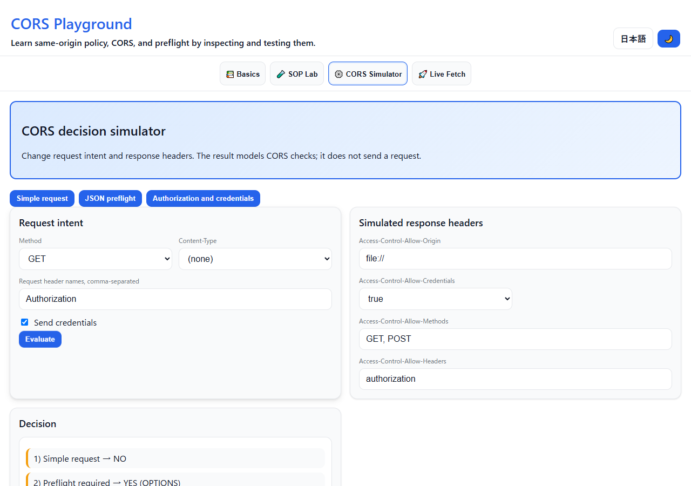
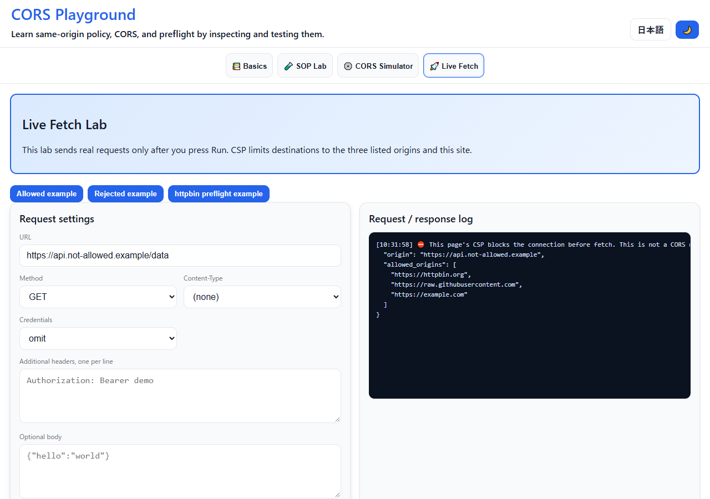

English · [日本語](README.md)

# CORS Playground - Interactive SOP, CORS, and preflight lab


[](https://ipusiron.github.io/cors-playground/)

**Day100 - 100 Security Tools with Generative AI**

CORS Playground is a dependency-free browser lab for learning Same-Origin Policy (SOP), CORS response checks, and preflight requests. It separates a page's own CSP restrictions from CORS and from failures that Fetch API cannot diagnose by itself.

---

## 🌐 Demo

👉 **[https://ipusiron.github.io/cors-playground/](https://ipusiron.github.io/cors-playground/)**

At the root URL, the initial language follows `?lang=ja|en`, a saved choice, and then the browser language. Opening `index.html` or `index.en.html` directly keeps that document's language.

---

## 📸 Screenshots

>
>*HTTP response-cache Vary conditions and cookie transmission conditions shown separately from CORS permission*
>
>
>*A CSP block identified before it can be mistaken for CORS*

---

## 🎯 Purpose

The lab addresses four questions:

- Which scheme, host, and port combinations are the same origin?
- Which request headers and values trigger a preflight?
- How do ACAO, ACAC, ACAM, and ACAH affect the browser's decision?
- Why can a Fetch API `TypeError` not prove that CORS was the cause?

---

## 👥 Intended audience

- Learners and instructors studying browser security
- Web developers debugging API integrations
- Security reviewers explaining CORS misconfigurations
- CTF players learning the underlying browser rules

The simulator is an educational model, not a scanner or proof of server-side behavior.

---

## 🧩 Four tabs

### 1. **Basics**

- Introduces origin, SOP, iframes, simple requests, and preflight.
- Uses keyboard-operable disclosures with explicit expanded state.

### 2. **SOP Lab**

- Compares DOM access to a same-origin iframe and an opaque-origin sandboxed iframe.
- Demonstrates explicit `postMessage` communication and sender validation.

### 3. **CORS Decision Simulator**

- Evaluates method, complete request-header values, credentials, and simulated response headers.
- Supports `Range`, the 128-byte per-value rule, the 1,024-byte combined safelist rule, and wildcard behavior for ACAM and ACAH.
- Treats `Authorization` as a non-wildcard request-header name.
- Separates response headers readable by JavaScript using the response-header safelist and ACEH, including the credentials wildcard rule.
  - `Set-Cookie` and `Set-Cookie2` remain forbidden even when listed in ACEH.
- Models a second request against `Access-Control-Max-Age` on a timeline; this is not a browser measurement.
- Shows the HTTP exchange in order: OPTIONS when required, the actual request, the response, and JavaScript readability. A rejected preflight stops before the actual request.
- Evaluates whether an origin-dependent cacheable response includes `Vary: Origin`, separately from the preflight cache.
- Separates CORS permission from cookie transmission conditions such as SameSite, Secure, and third-party-cookie policy. CORS success does not prove that a cookie was sent.
- Creates versioned fragment share links from safe simulator conditions and automatically restores the same result.
- Keeps only safe simulator inputs, the selected tab, and disclosure state in same-tab `sessionStorage` during a language switch.

### 4. **Live Fetch Lab**

- Offers three presets for GitHub Raw, example.com, and httpbin.
- Restricts external connections to those exact origins through CSP and a matching pre-check.
- Reports CSP separately and describes other Fetch failures as indeterminate until DevTools evidence is inspected.

---

## 🧠 Learning scenarios

| Scenario | What to compare |
|---|---|
| Simple GET | No preflight, followed by the response's ACAO check |
| JSON POST | `Content-Type: application/json` triggers OPTIONS |
| Authorization | Explicit ACAH permission is required; `ACAH: *` does not match Authorization |
| Credentialed request | Compare exact ACAO and `ACAC: true` with the separate cookie transmission conditions |
| CSP-restricted URL | The request is stopped before CORS is evaluated |
| ACEH wildcard | Compare readable response headers with and without credentials |
| Preflight cache | Compare a second request before expiry, at expiry, and after match conditions change |
| Dynamic ACAO and HTTP caching | Check `Vary: Origin` when a cacheable response changes by request origin |

---

## 🎓 Use cases

### 1. 🚩 CTF and challenge preparation

Model the headers in a challenge before interpreting browser console output. The lab helps distinguish an insecure server configuration from a client-side CSP restriction.

### 2. 🔴 Authorized security review

Use the simulator to explain a finding with reproducible request intent and response-header assumptions. Confirm the real endpoint with an intercepting proxy, DevTools, and server evidence; this page does not perform an audit.

### 3. 💻 Web application development

Compare a planned frontend request with the server's OPTIONS behavior before deployment. The core also exposes why a header name can be safelisted while its value is not.

### 4. 🎯 Education and workshops

Run the four tabs as a short progression: origin boundaries, iframe behavior, modeled decisions, and controlled live requests. The same examples are available in Japanese and English.

---

## 🧩 Background

### 🔸 Same-Origin Policy (SOP)

SOP is a browser security policy that restricts scripts from reading or manipulating resources belonging to another origin. An origin consists of scheme, host, and port.

### 🔸 Cross-Origin Resource Sharing (CORS)

CORS is a protocol in which a server uses response headers to grant a browser access to selected cross-origin responses. It is not authentication, network access control, or a replacement for authorization.

### 🔸 CORS-safelisted request conditions

The decision depends on method and on complete header names and values. Each safelisted value is limited to 128 bytes, and the combined safelisted value size can also make headers unsafe. `Content-Type` is safelisted only for three media-type essences.

### 🔸 Preflight requests

For a request outside the safelist, the browser sends OPTIONS first. If the response does not allow the proposed method and headers, the actual request is not sent.

### 🔸 Credentials

A credentialed CORS request cannot use `Access-Control-Allow-Origin: *`. It requires an exact origin and `Access-Control-Allow-Credentials: true`.

---

## 📘 References

### Official specifications and guidance

- WHATWG: [Fetch Standard - CORS protocol](https://fetch.spec.whatwg.org/#cors-protocol)
- W3C: [Content Security Policy Level 3](https://www.w3.org/TR/CSP3/)
- MDN: [Cross-Origin Resource Sharing](https://developer.mozilla.org/en-US/docs/Web/HTTP/CORS)
- OWASP WSTG: [Cross Origin Resource Sharing](https://wstg.owasp.org/latest/4-Web_Application_Security_Testing/11-Client-side/07-Cross_Origin_Resource_Sharing/)

### Developer documentation

- [Technical notes](TECHNICAL.md)

---

## 🔒 Security notes

### Controls available on GitHub Pages

- A meta-delivered CSP restricts scripts to `'self'` and connections to three exact external origins.
- The iframe documents also use CSP: the same-origin frame loads an external handler, while the sandbox runs only a fixed hash-authorized handler.
- Dynamic output uses `textContent`, DOM creation, and `replaceChildren()`.
- URL validation accepts only HTTP(S), then checks the origin against the CSP allowlist.
- Shared fragments validate the version, total length, allowed keys, types, enums, string lengths, and numeric ranges.
- The referrer policy is `strict-origin-when-cross-origin`.

`X-Content-Type-Options`, `Permissions-Policy`, and `X-Frame-Options` are HTTP response headers. They are not implemented through ineffective meta elements. Likewise, `frame-ancestors` is ignored in a meta-delivered CSP.

### Usage limits

- Live requests are sent only after the user presses Run.
- This tool does not send inputs to an operator-controlled collection service.
- Theme and language are stored in `localStorage`. During a language switch, safe simulator conditions, the selected tab, and disclosure state are stored temporarily in `sessionStorage` and removed when restored.
- A share link contains simulator conditions in its URL fragment. Live Fetch URLs, additional header values, bodies, and logs, as well as postMessage inputs and logs, are excluded from both sharing and language-switch storage.
- It cannot prove that an actual request reached a server.
- It cannot distinguish CORS, DNS, TLS, offline, and other network failures from a Fetch API `TypeError` alone.
- It does not audit authentication, authorization, or the security of a production server.
- The preflight cache timeline cannot prove an implementation's cap, early eviction, or actual omission of OPTIONS.
- CORS permission cannot prove that a cookie was sent. Domain, Path, expiry, stored state, SameSite, Secure, and browser policy require separate evidence.
- The `Vary: Origin` result evaluates the entered cache assumptions. It does not observe storage or reuse by a CDN, proxy, or browser cache.

Use DevTools and server-side evidence, and test only systems you are authorized to access.

---

## 📁 Directory structure

```text
cors-playground/
├── index.html / index.en.html       # Japanese and English UI
├── README.md / README.en.md         # Japanese and English documentation
├── TECHNICAL.md                     # Implementation notes
├── css/style.css                    # Shared responsive styles
├── js/
│   ├── cors-core.js                 # Dependency-free decision core
│   ├── messages.js                  # Dynamic Japanese and English messages
│   ├── theme-init.js                # Applies the saved theme before the first paint
│   ├── language-init.js             # Initial language selection
│   ├── app.js                       # Tabs, theme, and disclosures
│   ├── sop-lab.js                   # iframe and postMessage lab
│   ├── cors-simulator.js            # Simulator UI
│   └── live-fetch.js                # Controlled live requests
├── labs/                            # Japanese and English iframe documents and handler
│   └── iframe-lab.js                # Frame-side postMessage handler
├── test/                            # node:test suite
├── assets/                          # Japanese screenshots
└── assets/en/                       # English screenshots
```

---

## 📄 License

See [LICENSE](LICENSE). The application has no runtime library dependencies.

---

## 🛠️ About this tool

This tool is part of the “100 Security Tools with Generative AI” project, which explores building and publishing one browser-based security tool each day with AI assistance.

🔗 [https://akademeia.info/?page_id=42163](https://akademeia.info/?page_id=42163)
