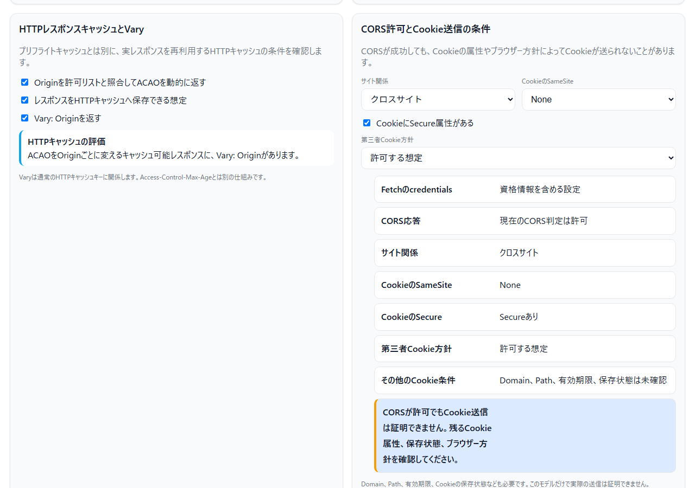
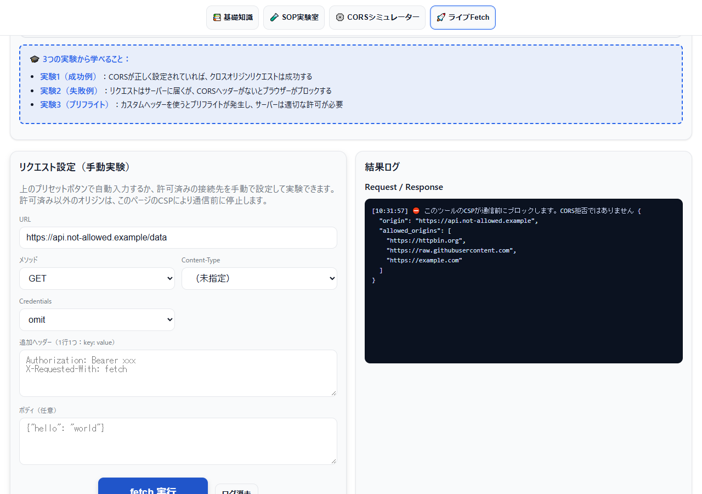

<!--
---
id: day100
slug: cors-playground

title: "CORS Playground"

subtitle_ja: "SOP・CORS・プリフライトの学習ツール"
subtitle_en: "Interactive learning tool for SOP, CORS, and Preflight requests"

description_ja: "同一オリジンポリシー（SOP）、CORS、プリフライトリクエストの仕組みを「理論」「可視化」「実験」の3軸で学べるインタラクティブ学習ツール"
description_en: "Interactive playground to understand Same-Origin Policy, CORS, and preflight requests through visual simulation and live fetch experiments"

category_ja:
  - Webセキュリティ
category_en:
  - Web Security

difficulty: 3

tags:
  - cors
  - sop
  - same-origin-policy
  - preflight
  - web-security
  - javascript
  - education
  - ctf

repo_url: "https://github.com/ipusiron/cors-playground"
demo_url: "https://ipusiron.github.io/cors-playground/"

hub: true
---
-->

# CORS Playground - SOP・CORS・プリフライトの学習ツール

[English](README.en.md) · 日本語


[](https://ipusiron.github.io/cors-playground/)

**CORS Playground** は、ブラウザー仕様の **同一オリジンポリシー（SOP：Same-Origin Policy）**、**CORS（Cross-Origin Resource Sharing）**、そして **プリフライトリクエスト** の仕組みを「理論」「可視化」「実験」の3軸で学べるインタラクティブ学習ツールです。

---

## 🌐 デモページ

👉 **[https://ipusiron.github.io/cors-playground/](https://ipusiron.github.io/cors-playground/)**

ルートURLの初期言語は、`?lang=ja|en`、保存済みの選択、ブラウザー言語の順で決まります。`index.html`または`index.en.html`を直接開いた場合は、その文書の言語を維持します。

ブラウザーで直接お試しいただけます。

---

## 📸 スクリーンショット

>
>*HTTPレスポンスキャッシュのVary条件と、CORSとは別のCookie送信条件を根拠付きで表示*
>
>
>*CSPによる事前拒否をCORSエラーと区別*

---

## 🎯 目的
このツールは、次のような疑問を体験的に理解することを目的としています。

- 「同一オリジンポリシーって、実際どんな制約をしているのか？」
- 「fetch() の失敗だけでは、なぜCORS・CSP・通信障害を区別できないのか？」
- 「プリフライトリクエスト（OPTIONS）は、いつ・なぜ送られるのか？」
- 「`Access-Control-Allow-Origin` や `Credentials` の関係って、どう整理すればいいのか？」

---

## 👥 対象ユーザー

このツールは、以下のような方々を対象としています。

- 🚩 **CTF参加者・セキュリティ競技プレイヤー**
  - Web問題でCORS関連の脆弱性を理解・活用したい方
  - CORS misconfigurationの仕組みを体系的に学びたい方

- 🔴 **セキュリティエンジニア（レッドチーム・ペンテスター）**
  - Webアプリケーションのセキュリティ評価を行う方
  - CORS設定の脆弱性を診断・報告する方

- 💻 **Webアプリケーション開発者**
  - フロントエンド・バックエンドでCORS設定を実装する方
  - APIエンドポイントのCORSヘッダーを正しく設定したい方
  - fetch()やXMLHttpRequestのクロスオリジンリクエストをデバッグする方

- 🎓 **セキュリティ教育を受ける学生・受講者**
  - 大学の情報セキュリティ講義で学ぶ方
  - セキュリティ勉強会・ハンズオンに参加する方
  - Webセキュリティの基礎を体験的に理解したい方

- 📚 **セキュリティ講師・トレーナー・研修担当者**
  - 企業研修や教育プログラムで使える教材を探している方
  - CORS/SOPを視覚的に説明したい方
  - ハンズオン形式の演習を提供したい方

- 🔧 **トラブルシューティング担当者**
  - 本番環境でCORSエラーが発生し、原因を特定したい方
  - 「なぜfetch()が失敗するのか」を段階的に切り分けたい方
  - サーバー側のCORS設定を検証・修正したい方

---

## 🧩 4つのタブ構成

### 1. **基礎知識**
- DOM、オリジン、iframe、SOPが必要な理由を順番に確認。
- アコーディオンはキーボード操作と読み上げに対応。

### 2. **SOP Lab**
- `iframe` と `sandbox` 属性を使い、**同一オリジン／異オリジン** の違いを体感。
- `postMessage` による安全な越境通信も確認可能。
- 「見えるけど触れない」── SOPの本質をUIで実感。

### 3. **CORS Decision Simulator**
- **アコーディオン形式の解説**：CORS基礎、用語集、シンプルリクエスト/プリフライトの詳細説明を収録
- **段階的実験ガイド**：3つのプリセット（Simple/JSON/Authorization）を段階的に試せる
  - 各実験ステップに詳細な説明とプリセットボタンを配置
  - セットされる内容と期待される結果を表形式で可視化
  - 実験結果の比較まとめ表を提供
- **入力フォーム**：メソッド、ヘッダー、Content-Type、Credentialsを自由に指定可能
- **判定結果**：シンプルリクエスト判定 → プリフライト要否 → 最終可否を **フローチャート形式** で視覚化
- **HTTP通信フロー**：OPTIONS、本リクエスト、本レスポンス、JavaScriptからの読取を順に表示し、プリフライト拒否時は本リクエストが送られないことを明示
- **レスポンスヘッダー公開判定**：CORS safelisted response-headerとACEHから、JavaScriptで読める名前を確認
  - `Set-Cookie`と`Set-Cookie2`はACEHへ列挙しても公開しない
- **プリフライトキャッシュモデル**：`Access-Control-Max-Age`と2回目の要求時刻を時間軸で比較
- **HTTPレスポンスキャッシュ**：オリジンごとにACAOを変える応答について、`Vary: Origin`の有無を確認。プリフライトキャッシュとは別の仕組みとして扱う
- **Cookie送信条件**：CORS応答の許可と、SameSite・Secure・第三者Cookie方針などの送信条件を分けて確認。CORS許可だけではCookie送信を証明しない
- **共有リンク**：秘密値を含まないシミュレーター条件をURLフラグメントで共有し、同じ結果まで自動復元
- **言語切替の状態保持**：安全なシミュレーター入力、選択タブ、折りたたみ状態だけを同一タブの`sessionStorage`で一時保持
- 各判定結果には詳細な根拠説明が表示される

### 4. **Live Fetch Lab**
- **段階的実験ガイド**：3つのプリセットで実際のCORS挙動を体験
  - 実験1：✅ CORS許可サーバー（`https://raw.githubusercontent.com/...`）
  - 実験2：🚫 CORS拒否サーバー（`https://example.com/`）
  - 実験3：🧪 カスタムCORSヘッダー（`https://httpbin.org/response-headers?...`）
- **実行ログ**：fetch実行後、成功／失敗、レスポンスヘッダー、プリフライト推定を表示
- **原因の区別**：CSP拒否は通信前に明示し、Fetch APIだけでCORSと通信障害を断定しない
- **DevTools連携推奨**：ブラウザーのNetworkタブでOPTIONSリクエストを観察しながら学習可能
- **セキュリティ機能**：http/https以外のスキーム（file:, javascript:等）は自動ブロック

---

## 🧠 学習シナリオ例

| 演習 | 目的 |
|------|------|
| シンプルリクエストを作れ | `GET`＋セーフリストヘッダーでプリフライトなしの成功例を確認 |
| プリフライトを引き起こせ | `POST`＋`Content-Type: application/json` で OPTIONS 発生 |
| ヘッダーが原因 | `Authorization: Bearer ...` が非セーフリストであることを確認 |
| Cookieを伴うリクエスト | CORS側の`ACAC`と、SameSite・Secure・第三者Cookie方針を別々に確認 |
| ワイルドカードの罠 | `ACAO: *` と `withCredentials: true` の併用禁止を確認 |
| メソッド不一致 | `DELETE` 送信時、`ACAM: GET, POST` のレスでブロックされる例を観察 |
| ACEHのワイルドカード | 資格情報なし／ありで、`ACEH: *`から読めるレスポンスヘッダーが変わることを比較 |
| プリフライトキャッシュ | Max-Ageの期限内・期限ちょうど・条件変更で、2回目のOPTIONSモデルが変わることを比較 |
| 動的ACAOとHTTPキャッシュ | オリジンごとに応答を変える場合の`Vary: Origin`を確認 |

---

## 🎓 活用シナリオ

このツールは、セキュリティ学習から実践的な演習まで、幅広いシーンで活用できます。

### 1. 🚩 CTF（Capture The Flag）での活用

**シーン：** Web問題でCORS関連の脆弱性を発見・悪用する前の事前学習

**具体的な使い方：**
- **CORSシミュレーター**で、様々なヘッダー組み合わせでの挙動を予測
- サーバーが`Access-Control-Allow-Origin: *`を返す場合と、具体的オリジンを返す場合の違いを理解
- `withCredentials: true`時の制約を把握し、認証情報を伴うリクエストの可否を判断
- プリフライトリクエスト（OPTIONS）の発生条件を理解し、サーバー側の検証バイパス手法を検討

**学習効果：**
- CORS misconfiguration（設定ミス）を発見する視点を養う
- 「なぜこのリクエストはブロックされるのか」を論理的に説明できるようになる
- 実際のエクスプロイト前に、ブラウザーの挙動を完全に理解できる

---

### 2. 🔴 レッドチーム演習・ペネトレーションテストでの活用

**シーン：** 組織のWebアプリケーションに対するセキュリティ評価（許可された範囲内）

**具体的な使い方：**
- **ライブFetchタブ**で、ターゲットサーバーのCORS設定を実際に検証
- プリフライトリクエストの有無を確認し、サーバーが適切な検証を行っているかチェック
- `Access-Control-Allow-Origin`が動的に返される場合の挙動をテスト
- Credentialsを含むリクエストでのレスポンスヘッダーを確認し、設定ミスを発見

**報告書作成時の活用：**
- CORSシミュレーターの結果をキャプチャし、「正しい設定」と「現状の設定」を比較
- プリフライトの流れを視覚的に説明し、クライアントへの理解促進
- 修正推奨事項として、正しいヘッダー設定例を提示

**重要な注意事項：**
⚠️ このツールは教育・演習目的です。実際のペネトレーションテストでは、**必ず事前の許可を得た範囲内**でのみ使用してください。無許可でのセキュリティテストは違法です。

---

### 3. 💻 Webアプリケーション開発での活用

**シーン：** フロントエンド・バックエンド開発時のCORS設定検証

**具体的な使い方：**
- **開発前：** CORSシミュレーターで、実装予定のAPIエンドポイントに必要なヘッダーを事前確認
- **開発中：** ライブFetchタブで、実装したAPIが正しくCORSヘッダーを返しているか検証
- **デバッグ時：** 「なぜfetch()が失敗するのか」を段階的に切り分け
  - シンプルリクエスト条件を満たしているか？
  - プリフライトで適切なヘッダーを返しているか？
  - Credentials使用時にワイルドカードを使っていないか？

**チーム内での活用：**
- 新メンバーへのCORS教育教材として活用
- コードレビュー時の設定ミス防止チェックリストとして参照
- QAチームがテストケースを作成する際の仕様理解ツールとして使用

---

### 4. 🎯 セキュリティ教育・研修での活用

**シーン：** 企業研修、大学講義、セキュリティ勉強会

**具体的な使い方：**
- **理論学習：** 各タブのアコーディオン形式の解説で、DOM、オリジン、SOP、CORSの概念を体系的に学習
- **実験による体験：** SOP Labで「見えるけど触れない」制約を実際に体感
- **段階的理解：** CORSシミュレーターの段階的実験ガイドで、3つのプリセット（Simple/JSON/Authorization）を順に試し、難易度を上げながら理解を深める
- **実践演習：** ライブFetchタブの段階的実験ガイドで成功例・失敗例を試し、ブラウザーのDevToolsと併用して学習

**教育効果：**
- 「なぜCORSが必要なのか」を理論だけでなく、実際の挙動で理解できる
- 開発者が陥りがちなCORS設定ミスを事前に体験し、予防できる
- セキュリティ意識の向上とベストプラクティスの習得

**ハンズオン研修例：**
1. SOP Labで同一オリジン制約を体験（15分）
2. CORSシミュレーターで判定ロジックを理解（20分）
3. ライブFetchで実際のサーバー挙動を観察（25分）
4. グループディスカッション：「自社アプリのCORS設定は安全か？」（20分）

---

## 🧩 背景知識まとめ

### 🔸 同一オリジンポリシー（SOP：Same-Origin Policy）

**概要：**
- すべての主要ブラウザーで**デフォルトで有効**になっているセキュリティ機構
- オリジン（**スキーム／ホスト／ポート**）が異なる場合、様々なリソースへのアクセスを制限
- Webセキュリティの**根幹ルール**であり、Webの"安全な壁"

**SOPによる主な制限：**
1. **クロスオリジン応答の読み取り**
   - `fetch()` や `XMLHttpRequest`では、サーバーがCORSヘッダーで許可しない限り、JavaScriptから応答を読み取れない。プリフライトの有無により、本リクエストが送られるかどうかは異なる

2. **frame内のクロスオリジンページへのアクセス**
   - `<iframe>` 内に異なるオリジンのページを読み込んだ場合、親ページから `contentDocument` などでDOMにアクセスできない

3. **クロスオリジン画像を読み込んだ `<canvas>` 要素のデータへのアクセス**
   - 異なるオリジンの画像を `<canvas>` に描画した場合、`toDataURL()` や `getImageData()` などが「汚染された (tainted)」として失敗する

4. **Web Storage / IndexedDB のクロスオリジンデータへのアクセス**
   - `localStorage`, `sessionStorage`, `IndexedDB` はオリジンごとに完全に分離されており、異なるオリジンのデータには一切アクセスできない

### 🔸 CORS（Cross-Origin Resource Sharing）
- サーバーがブラウザーに対して「このリクエストは越境OK」と宣言する仕組み。
- `Access-Control-Allow-Origin` などのヘッダーで許可を表明する。

### 🔸 シンプルリクエスト（Simple Request）の条件
- メソッド：`GET`, `HEAD`, `POST`
- Content-Type：`text/plain`, `application/x-www-form-urlencoded`, `multipart/form-data`
- 付加ヘッダー：値も条件を満たす`Accept`、`Accept-Language`、`Content-Language`、`Content-Type`、単一範囲の`Range`
- 値ごとの上限は128バイト。セーフリスト候補の値の合計が1,024バイトを超えた場合も対象外

### 🔸 プリフライトリクエスト（Preflight Request）
- 上記条件を外れると、`OPTIONS` メソッドで事前照会が送られる。
- サーバーが `ACAM` や `ACAH` で許可を返さないと**本リクエストは実行されない**。
- 資格情報なしではACAM／ACAHの`*`をワイルドカードとして扱う。資格情報付きでは`*`をワイルドカードとして扱わず、`Authorization`は資格情報なしでも明示が必要。

### 🔸 資格情報（Credentials）
- `fetch(url, { credentials: 'include' })` などを指定した場合、
  - `Access-Control-Allow-Credentials: true` が必須。
  - 同時に `Access-Control-Allow-Origin: *` は使えない。

---

## 📘 関連資料

### 公式ドキュメント
- MDN: [HTTP access control (CORS)](https://developer.mozilla.org/en-US/docs/Web/HTTP/CORS)
- WHATWG: [Fetch Standard – CORS protocol](https://fetch.spec.whatwg.org/#cors-protocol)
- OWASP WSTG: [Cross Origin Resource Sharing](https://wstg.owasp.org/latest/4-Web_Application_Security_Testing/11-Client-side/07-Cross_Origin_Resource_Sharing/)

### 開発者向けドキュメント
- **[技術仕様書（TECHNICAL.md）](TECHNICAL.md)** - 実装の詳細、コアアルゴリズム、設計の工夫を解説

---

## 🔒 セキュリティに関する注意事項

### GitHub Pages公開時のセキュリティ対策

このツールは以下のセキュリティ対策を実装しています：

#### 1. **Content Security Policy (CSP)**
- `default-src 'self'` - 基本的に同一オリジンからのリソースのみ許可
- `script-src 'self'` - 同一オリジンの外部スクリプトだけを許可
- iframe文書にもCSPを設定し、同一オリジン側は外部スクリプト、sandbox側はハッシュ許可した固定スクリプトだけを実行
- `style-src 'self' 'unsafe-inline'` - 同一オリジンのスタイルとインラインスタイルを許可
- `connect-src` - ライブFetch実験用に以下の外部オリジンへの接続を許可：
  - `https://httpbin.org` - CORS動作確認用テストサーバー
  - `https://raw.githubusercontent.com` - GitHub Rawコンテンツ（実験用）
  - `https://example.com` - CORS拒否例の確認用
- `object-src 'none'` - プラグインの実行を禁止
- `base-uri 'self'` - `<base>`タグのURLを同一オリジンに制限
- `form-action 'self'` - フォーム送信先を同一オリジンに制限
- `upgrade-insecure-requests` - HTTP接続を自動的にHTTPSへアップグレード

**注意**: `frame-ancestors`ディレクティブは、`<meta>`タグ経由のCSPでは効果がないため含まれていません（HTTPレスポンスヘッダーでのみ有効）。

#### 2. **XSS（クロスサイトスクリプティング）対策**
- ユーザー入力と動的な説明は`textContent`とDOM APIで挿入
- 既存表示の消去は`replaceChildren()`を使用
- 入力値の検証とエスケープを実装
- 共有フラグメントはバージョン、総長、許可キー、型、列挙値、文字数、数値範囲を検査

#### 3. **URL検証（ライブFetch機能）**
- 安全でないURLスキーム（`file:`, `javascript:`, `data:`等）を自動的にブロック
- http/httpsだけを受け付け、CSPの許可済みオリジンと照合
- 無効なURL形式は実行前にエラー表示

#### 4. **GitHub Pagesで設定できないヘッダー**

`X-Content-Type-Options`、`Permissions-Policy`、`X-Frame-Options`はHTTPレスポンスヘッダーで設定する項目です。meta要素では有効にならず、GitHub Pagesではリポジトリーから設定できないため、実装済みとは扱いません。`Referrer-Policy: strict-origin-when-cross-origin`に相当するmeta要素は有効です。

### 利用上の注意事項

#### ⚠️ 教育・学習目的での使用
- このツールは**教育・学習目的**で設計されています
- セキュリティ脆弱性を悪用するためのツールではありません
- 実際のWebアプリケーションに対する無許可のテストは違法です

#### 🔍 プライバシーへの配慮
- このツールは入力を運営者のサーバーへ収集・送信しません
- すべての処理はブラウザー内（クライアントサイド）で完結します
- 外部サーバーへのリクエストは、ユーザーが明示的に実行した場合のみ送信されます
- テーマと言語は`localStorage`に保存します。言語切替時は、安全なシミュレーター条件、選択タブ、折りたたみ状態だけを`sessionStorage`へ一時保存し、復元時に削除します
- 共有リンクにはシミュレーター条件がURLフラグメントとして含まれます。Live FetchのURL・追加ヘッダー値・本文・ログ、postMessageの入力・ログは、共有リンクにも言語切替用の保存にも含めません

#### 🛡️ ライブFetch機能の責任ある使用
ライブFetchタブでは、`connect-src`で許可した3つの外部オリジンと同一オリジンだけにリクエストを送信できます。
- **他者のサーバーに対する過度なリクエストは避けてください**
- テスト用途では、自身が管理するサーバーまたは公式テストサーバー（httpbin.org等）を使用してください
- DDoS攻撃やその他の悪意ある行為に使用しないでください

#### ⚠️ 判定できないこと

- Fetch APIの`TypeError`だけから、CORS拒否、DNS、TLS、オフラインを断定すること
- 対象サーバーへ本リクエストが到達したことを証明すること
- サーバー設定や認可の安全性を監査すること
- DevToolsやサーバーログを使わず、実際のOPTIONS応答を確認すること
- プリフライトキャッシュの実際の上限、早期削除、OPTIONS省略を証明すること
- CORS許可だけから、Cookieが送信されたことを証明すること。Domain、Path、有効期限、保存状態、SameSite、Secure、ブラウザー方針などは別途確認が必要です
- `Vary: Origin`の表示は、入力したキャッシュ条件の教育用評価です。実際のCDN・プロキシー・ブラウザーキャッシュの保存や再利用を観測するものではありません

#### 📋 セキュリティ問題の報告
もしセキュリティ上の問題を発見された場合は、GitHubのIssuesから報告してください。
責任を持って対応いたします。

---

## 📁 ディレクトリー構成

```
cors-playground/
├─ index.html              # 日本語画面
├─ index.en.html           # 英語画面
├─ README.md               # 日本語説明書
├─ README.en.md            # 英語説明書
├─ TECHNICAL.md            # 開発者向け技術仕様書
├─ LICENSE                 # MITライセンス
├─ .gitignore              # Git除外設定
├─ .nojekyll               # GitHub Pages設定（Jekyllビルド無効化）
├─ css/
│  └─ style.css           # メインスタイルシート（CSS変数ベース）
├─ js/
│  ├─ app.js              # タブ切替・テーマ制御
│  ├─ cors-core.js        # 仕様判定の共通コア
│  ├─ messages.js         # 日英の動的メッセージ
│  ├─ theme-init.js       # 最初の描画の前に保存したテーマを付ける
│  ├─ language-init.js    # 初期言語の決定
│  ├─ sop-lab.js          # SOP実験（iframe + postMessage）
│  ├─ cors-simulator.js   # シミュレーター画面
│  └─ live-fetch.js       # 実リクエスト実験・URL検証
├─ labs/
│  ├─ iframe-lab.js       # iframe側のpostMessage処理
│  ├─ iframe-safe.html / iframe-safe.en.html
│  └─ iframe-sandboxed.html / iframe-sandboxed.en.html
├─ test/                  # node:testによる自動テスト
├─ package.json           # テストコマンド
└─ assets/
   ├─ screenshot.png / screenshot2.png
   └─ en/                 # 英語画面の画像
```

---

## 📄 ライセンス

MIT License – 詳細は [LICENSE](LICENSE) を参照してください。

---

## 🛠️ このツールについて

本ツールは、「生成AIで作るセキュリティツール100」プロジェクトの一環として開発されました。
このプロジェクトでは、AIの支援を活用しながら、セキュリティに関連するさまざまなツールを100日間にわたり制作・公開していく取り組みを行っています。

プロジェクトの詳細や他のツールについては、以下のページをご覧ください。

🔗 [https://akademeia.info/?page_id=42163](https://akademeia.info/?page_id=42163)
